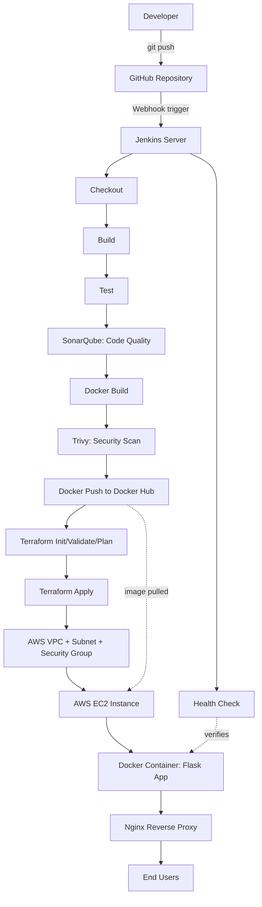

# Automated CI/CD Pipeline using Jenkins, Docker, Terraform and AWS

A complete, runnable, college-level DevOps project demonstrating an end-to-end
automated CI/CD pipeline: a developer pushes code to GitHub, Jenkins builds,
tests, scans and containerizes the app, pushes it to Docker Hub, and Terraform
provisions AWS infrastructure and deploys the container — automatically.

---

## Table of Contents

1. [Project Overview](#1-project-overview)
2. [Problem Statement](#2-problem-statement)
3. [Objectives](#3-objectives)
4. [Architecture](#4-architecture)
5. [Technologies Used](#5-technologies-used)
6. [System Requirements](#6-system-requirements)
7. [Installation](#7-installation)
8. [AWS Configuration](#8-aws-configuration)
9. [Jenkins Setup](#9-jenkins-setup)
10. [Jenkins Credentials Setup](#10-jenkins-credentials-setup)
11. [Docker Hub Setup](#11-docker-hub-setup)
12. [Terraform Setup](#12-terraform-setup)
13. [GitHub Webhook Setup](#13-github-webhook-setup)
14. [Pipeline Execution](#14-pipeline-execution)
15. [Expected Output](#15-expected-output)
16. [Troubleshooting](#16-troubleshooting)
17. [Security Considerations](#17-security-considerations)
18. [Future Enhancements](#18-future-enhancements)
19. [Conclusion](#19-conclusion)
20. [Step-by-Step Execution Guide (Empty Ubuntu → Deployed App)](#20-step-by-step-execution-guide-empty-ubuntu--deployed-app)
21. [Viva Questions](#21-viva-questions)

---

## 1. Project Overview

This project implements a fully automated **CI/CD (Continuous
Integration / Continuous Deployment)** pipeline for a small Flask web
application. It uses **Jenkins** as the automation server, **Docker** for
containerization, **Docker Hub** as the container registry, **Terraform**
for Infrastructure as Code (IaC), and **AWS EC2** as the target deployment
environment, fronted by **Nginx** as a reverse proxy.

Every push to the GitHub repository triggers Jenkins (via a webhook), which
runs the entire pipeline — build, test, code-quality analysis, security
scanning, image build/push, infrastructure provisioning, deployment, and a
final health check — with **zero manual intervention**.

## 2. Problem Statement

Manual software delivery is slow and error-prone: developers build and test
locally, manually copy artifacts to servers, and manually reconfigure
infrastructure. This causes inconsistent environments, delayed releases,
and human error in production deployments. This project solves that by
automating every step from `git push` to a live, health-checked
application running on AWS.

## 3. Objectives

- Automate build, test, and code-quality checks on every code change.
- Containerize the application using Docker for environment consistency.
- Scan container images for known vulnerabilities before deployment.
- Provision AWS infrastructure repeatably and version-controlled using
  Terraform (Infrastructure as Code).
- Automatically deploy the new container version to AWS EC2.
- Verify deployment success with an automated health check.
- Follow security best practices: no hardcoded credentials, least-privilege
  IAM, restricted SSH access.

## 4. Architecture

```
Developer
   │  git push
   ▼
GitHub Repository
   │  webhook (POST /github-webhook/)
   ▼
Jenkins Server
   │
   ├─ Checkout ──► Build ──► Test ──► SonarQube (Code Quality)
   │
   ├─ Docker Build ──► Trivy (Security Scan) ──► Docker Push
   │
   ├─ Terraform Init/Validate/Plan/Apply ──► AWS (VPC, Subnet, SG, EC2)
   │
   └─ Deploy (SSH) ──► Docker Container on EC2 ──► Nginx (reverse proxy)
                                                          │
                                                          ▼
                                                        Users
```

### Mermaid diagram



### Infrastructure layout

- **VPC** (`10.0.0.0/16`) containing:
  - 1 **public subnet** (`10.0.1.0/24`)
  - 1 **Internet Gateway** + **route table** for public internet access
  - 1 **Security Group** allowing SSH (restricted), HTTP (80), and the
    app port (5000)
  - 1 **EC2 instance** (Ubuntu 22.04) with an **IAM instance profile**,
    running Docker + Nginx

## 5. Technologies Used

| Category            | Technology                          |
|----------------------|--------------------------------------|
| Source control       | Git, GitHub                          |
| CI/CD automation     | Jenkins (Declarative Pipeline)       |
| Containerization     | Docker, Docker Hub                   |
| Infrastructure as Code | Terraform (AWS provider)           |
| Cloud provider        | AWS (VPC, EC2, Security Groups, IAM) |
| Web/reverse proxy     | Nginx                                |
| Application           | Python 3.12, Flask, Gunicorn         |
| Code quality           | SonarQube                            |
| Security scanning     | Trivy                                |
| OS / scripting        | Ubuntu Linux, Bash                   |

## 6. System Requirements

**Local / Jenkins machine:**
- Ubuntu 22.04 LTS (or similar), 2 vCPU / 4GB RAM minimum (Jenkins + SonarQube need more; 8GB recommended)
- Git, Docker Engine, Terraform ≥ 1.5, Java 17 (for Jenkins), Python 3.12
- An AWS account with programmatic (Access Key) credentials
- A Docker Hub account
- A GitHub account and repository

**Target AWS environment:**
- An AWS account with permissions to create VPC, EC2, IAM, and Security
  Group resources
- An existing EC2 Key Pair (for SSH access)

## 7. Installation

Clone the repository onto your Jenkins/build machine:

```bash
git clone https://github.com/YOUR_USERNAME/cicd-devops-project.git
cd cicd-devops-project
```

Run the application locally first to confirm it works before wiring up the
pipeline:

```bash
cd app
python3 -m venv .venv
source .venv/bin/activate
pip install -r requirements-dev.txt
python3 app.py
# Visit http://localhost:5000 and http://localhost:5000/health
```

Run the tests:

```bash
pytest tests -v
```

Build and run with Docker locally:

```bash
cd ..
docker build -t cicd-demo-app:local .
docker run -d -p 5000:5000 --name cicd-demo-app cicd-demo-app:local
curl http://localhost:5000/health
```

## 8. AWS Configuration

1. **Create an IAM user** for Jenkins/Terraform (do not use root credentials):
   ```bash
   aws iam create-user --user-name jenkins-cicd-user
   aws iam attach-user-policy --user-name jenkins-cicd-user \
     --policy-arn arn:aws:iam::aws:policy/AmazonEC2FullAccess
   aws iam attach-user-policy --user-name jenkins-cicd-user \
     --policy-arn arn:aws:iam::aws:policy/AmazonVPCFullAccess
   aws iam attach-user-policy --user-name jenkins-cicd-user \
     --policy-arn arn:aws:iam::aws:policy/IAMFullAccess
   ```
   > For a real production setup, replace these broad managed policies with
   > a least-privilege custom policy scoped to exactly the actions Terraform
   > needs (`ec2:*`, `iam:PassRole`, etc.).

2. **Generate an access key** for that user:
   ```bash
   aws iam create-access-key --user-name jenkins-cicd-user
   ```
   Save the `AccessKeyId` and `SecretAccessKey` — you will store these in
   Jenkins Credentials (never in code).

3. **Create an EC2 Key Pair** (for SSH access to the deployed server):
   ```bash
   aws ec2 create-key-pair --key-name cicd-project-key \
     --query 'KeyMaterial' --output text > cicd-project-key.pem
   chmod 400 cicd-project-key.pem
   ```
   USER MUST PROVIDE: the key pair name goes into
   `terraform.tfvars` as `key_pair_name`.

4. Note your **AWS region** and set `aws_region` / `availability_zone` in
   `terraform.tfvars` accordingly.

## 9. Jenkins Setup

Install Jenkins on Ubuntu:

```bash
sudo apt update
sudo apt install -y openjdk-17-jre
curl -fsSL https://pkg.jenkins.io/debian-stable/jenkins.io-2023.key | sudo tee \
  /usr/share/keyrings/jenkins-keyring.asc > /dev/null
echo "deb [signed-by=/usr/share/keyrings/jenkins-keyring.asc]" \
  "https://pkg.jenkins.io/debian-stable binary/" | sudo tee \
  /etc/apt/sources.list.d/jenkins.list > /dev/null
sudo apt update
sudo apt install -y jenkins
sudo systemctl enable --now jenkins
```

Get the initial admin password and finish setup in the browser at
`http://<jenkins-server-ip>:8080`:

```bash
sudo cat /var/lib/jenkins/secrets/initialAdminPassword
```

Install required plugins (**Manage Jenkins → Plugins**):
- Docker Pipeline
- Amazon Web Services SDK / Credentials Binding
- SSH Agent
- Git
- JUnit
- SonarQube Scanner (optional, for Code Quality stage)

Install Docker and Terraform **on the Jenkins server itself** (the pipeline
runs `docker` and `terraform` commands on the Jenkins agent):

```bash
# Docker
curl -fsSL https://get.docker.com | sudo sh
sudo usermod -aG docker jenkins
sudo systemctl restart jenkins

# Terraform
sudo apt install -y unzip
curl -fsSL https://releases.hashicorp.com/terraform/1.9.0/terraform_1.9.0_linux_amd64.zip -o terraform.zip
unzip terraform.zip && sudo mv terraform /usr/local/bin/
terraform -version
```

Create a new **Pipeline** job in Jenkins:
1. New Item → name it `cicd-devops-project` → select **Pipeline**.
2. Under **Pipeline**, choose **Pipeline script from SCM**.
3. SCM: Git → paste your GitHub repo URL → branch `main` → Script Path:
   `Jenkinsfile`.
4. Save.

## 10. Jenkins Credentials Setup

Go to **Manage Jenkins → Credentials → System → Global credentials → Add
Credentials**, and create the following (IDs must match the Jenkinsfile):

| Credential ID     | Type                              | Contains |
|--------------------|-------------------------------------|----------|
| `dockerhub-creds`  | Username with password              | Docker Hub username + access token |
| `aws-creds`        | AWS Credentials                     | Access Key ID + Secret Access Key |
| `ec2-ssh-key`      | SSH Username with private key       | `ubuntu` + contents of your `.pem` key |
| `github-creds`     | Username with password / PAT        | Only needed if the repo is private |

**None of these values are ever written into the repository.** The
Jenkinsfile references them only by ID via `credentials(...)` and
`withCredentials([...])`.

## 11. Docker Hub Setup

1. Create a free account at https://hub.docker.com.
2. Create a repository named `cicd-demo-app` (public or private).
3. Generate an **access token**: Account Settings → Security → New Access
   Token. USER MUST PROVIDE this token (and your Docker Hub username) as
   the `dockerhub-creds` Jenkins credential — do not use your account
   password.
4. Update `DOCKERHUB_USERNAME` in the `Jenkinsfile` `environment {}` block
   to your Docker Hub username.

## 12. Terraform Setup

```bash
cd terraform
cp terraform.tfvars.example terraform.tfvars
# Edit terraform.tfvars and fill in:
#   aws_region, availability_zone, key_pair_name, ssh_allowed_cidr, docker_image

terraform init
terraform validate
terraform plan
terraform apply     # type 'yes' to confirm
```

After `apply` completes, Terraform prints outputs including
`ec2_public_ip` and `application_url`. To tear down infrastructure when
finished (avoid ongoing AWS charges):

```bash
terraform destroy
```

## 13. GitHub Webhook Setup

This wires up automatic triggering: `push → webhook → Jenkins`.

1. In your GitHub repository: **Settings → Webhooks → Add webhook**.
2. **Payload URL:** `http://<your-jenkins-public-ip>:8080/github-webhook/`
   (note the trailing slash).
3. **Content type:** `application/json`.
4. **Which events:** "Just the push event".
5. Save. GitHub will send a test ping — check it shows a green checkmark.
6. In the Jenkins job configuration, under **Build Triggers**, enable
   **"GitHub hook trigger for GITScm polling"**.

Now every `git push` to the repository automatically triggers the full
pipeline:

```
Developer → git push → GitHub webhook → Jenkins → Checkout → Build → Test
→ Docker Build → Security Scan → Docker Hub → Terraform → AWS EC2 → Deploy
→ Health Check
```

> If your Jenkins server is not publicly reachable (e.g. running on a
> laptop), use a tunneling tool like `ngrok http 8080` for demo purposes,
> or trigger builds manually via **Build Now** for the viva.

## 14. Pipeline Execution

Trigger the pipeline either by:
- Pushing a commit: `git push origin main`, or
- Clicking **Build Now** on the Jenkins job page.

Watch progress in **Jenkins → cicd-devops-project → (build #) → Console
Output**, or the **Stage View** for a visual breakdown of all 14 stages.

## 15. Expected Output

- All 14 pipeline stages show green (success) in the Jenkins Stage View.
- A new image tag appears in Docker Hub, e.g.
  `yourusername/cicd-demo-app:12-a1b2c3d`.
- `terraform output application_url` shows something like
  `http://54.xxx.xxx.xxx:5000`.
- Visiting that URL (or port 80 via Nginx) shows the homepage with:
  project name, developer info, current app version, build number, git
  commit, and a "Healthy" pipeline status badge.
- `GET /health` returns:
  ```json
  {"status": "healthy", "service": "cicd-demo-app", "version": "12-a1b2c3d", "timestamp": "..."}
  ```

## 16. Troubleshooting

| Issue | Likely Cause / Fix |
|---|---|
| `docker: permission denied` in Jenkins logs | Jenkins user isn't in the `docker` group — run `sudo usermod -aG docker jenkins` and restart Jenkins. |
| `terraform init` fails with auth error | AWS credentials not bound correctly — verify the `aws-creds` credential ID and type (must be "AWS Credentials"). |
| Webhook never triggers a build | Check Jenkins is publicly reachable on port 8080; check the webhook's "Recent Deliveries" tab in GitHub for the response code. |
| `Health Check` stage times out | EC2 security group may not allow the app port; check `terraform output ec2_public_ip` and `curl` it manually; check `docker logs cicd-demo-app` on the instance. |
| `terraform apply` fails: `InvalidKeyPair.NotFound` | The `key_pair_name` in `terraform.tfvars` doesn't exist in the target region — create/import it first. |
| SSH deploy step fails: `Permission denied (publickey)` | Confirm the `ec2-ssh-key` Jenkins credential's username is `ubuntu` and the private key matches the key pair used to launch the instance. |
| SonarQube stage fails | Confirm a SonarQube server is configured in Manage Jenkins → System named `sonarqube-server`, or remove/skip this stage for a minimal demo. |

Useful debug commands:
```bash
# On Jenkins server
sudo journalctl -u jenkins -f

# On EC2 instance
ssh -i cicd-project-key.pem ubuntu@<ec2-ip>
docker ps -a
docker logs cicd-demo-app
sudo cat /var/log/user-data.log
sudo systemctl status nginx
```

## 17. Security Considerations

- **No hardcoded secrets:** all credentials are injected via Jenkins
  Credentials Binding and environment variables; `.gitignore` excludes
  `terraform.tfvars`, `*.pem`, and `.env`.
- **Least privilege:** the demo IAM policies are broad for simplicity —
  in a real deployment, scope them down to only the required actions.
- **Restricted SSH:** `ssh_allowed_cidr` should be set to your own IP
  (`/32`), not `0.0.0.0/0`.
- **Non-root container:** the Docker image runs as an unprivileged
  `appuser`, not root.
- **Image scanning:** Trivy scans every built image for known CVEs before
  it's pushed/deployed.
- **Docker Hub tokens, not passwords:** use scoped access tokens that can
  be revoked independently of your account password.
- **State file sensitivity:** `terraform.tfstate` can contain sensitive
  data — it's git-ignored here; use a remote encrypted backend (e.g. S3 +
  DynamoDB locking) for real/team use.

## 18. Future Enhancements

- Add a staging environment and blue/green or canary deployment strategy.
- Replace the single EC2 instance with an Auto Scaling Group behind an
  Application Load Balancer for high availability.
- Store Terraform state remotely (S3 + DynamoDB) for team collaboration.
- Add Slack/email notifications on pipeline success/failure.
- Enforce Trivy scan results as a hard gate (`--exit-code 1`) once the
  image is hardened.
- Migrate to AWS ECS/EKS for container orchestration at scale.
- Add HTTPS via Let's Encrypt/Certbot or an ACM certificate on an ALB.

## 19. Conclusion

This project demonstrates a realistic, secure, end-to-end DevOps CI/CD
workflow suitable for academic demonstration and viva: source control,
automated build/test, code quality analysis, container security scanning,
container registry integration, Infrastructure as Code, and automated
cloud deployment with health verification — all triggered by a single
`git push`.

## 20. Step-by-Step Execution Guide (Empty Ubuntu → Deployed App)

Assumes a fresh Ubuntu 22.04 machine and a beginner user.

1. **Update the system**
   ```bash
   sudo apt update && sudo apt upgrade -y
   ```
2. **Install Git** and clone the repo
   ```bash
   sudo apt install -y git
   git clone https://github.com/YOUR_USERNAME/cicd-devops-project.git
   cd cicd-devops-project
   ```
3. **Install Docker** (see Section 9) and verify: `docker --version`
4. **Install Terraform** (see Section 9) and verify: `terraform -version`
5. **Install AWS CLI** and configure it:
   ```bash
   sudo apt install -y awscli
   aws configure
   # Enter: Access Key ID, Secret Access Key, region, output format (json)
   ```
6. **Create AWS resources needed before Terraform**: IAM user + access
   key, and an EC2 key pair (Section 8).
7. **Install Jenkins** (Section 9), open `http://<ip>:8080`, complete the
   setup wizard, install suggested plugins plus the ones listed in
   Section 9.
8. **Add Jenkins credentials** exactly as listed in Section 10.
9. **Create the Docker Hub repository and access token** (Section 11) and
   update `DOCKERHUB_USERNAME` in the `Jenkinsfile`.
10. **Configure Terraform variables**:
    ```bash
    cd terraform
    cp terraform.tfvars.example terraform.tfvars
    nano terraform.tfvars   # fill in your values
    cd ..
    ```
11. **Create the Jenkins Pipeline job** pointing at your GitHub repo and
    `Jenkinsfile` (Section 9).
12. **Configure the GitHub webhook** (Section 13).
13. **Push a commit** (or click "Build Now") to trigger the pipeline:
    ```bash
    git commit --allow-empty -m "trigger pipeline"
    git push origin main
    ```
14. **Watch the Jenkins Stage View** as all 14 stages run in sequence.
15. **Get the deployed URL**:
    ```bash
    cd terraform
    terraform output application_url
    ```
16. **Open the URL in a browser** — you should see the homepage with live
    pipeline status, version, and build info.
17. **Verify health**: `curl $(terraform output -raw application_url)/health`
18. **(Optional) Tear down** when finished: `terraform destroy`

## 21. Viva Questions

1. **Q: What is CI/CD and why is it used?**
   A: CI (Continuous Integration) automatically builds and tests every code
   change; CD (Continuous Deployment) automatically ships passing changes to
   an environment. It reduces manual errors and speeds up delivery.

2. **Q: What triggers the Jenkins pipeline in this project?**
   A: A GitHub webhook sends a POST request to Jenkins whenever code is
   pushed, which triggers the configured pipeline job automatically.

3. **Q: Why use Docker instead of deploying the app directly on the VM?**
   A: Docker packages the app with all its dependencies into a portable,
   consistent image, eliminating "works on my machine" issues and making
   deployment reproducible across environments.

4. **Q: What is the purpose of the Docker multi-stage build here?**
   A: It separates the build environment (installing packages) from the
   runtime environment, keeping the final image smaller and free of
   unnecessary build tools.

5. **Q: Why does the Dockerfile run the app as a non-root user?**
   A: Running as non-root limits the impact of a container compromise —
   an attacker who breaks out of the app process doesn't get root
   privileges inside the container.

6. **Q: What is Terraform and why is it used instead of manually creating AWS resources?**
   A: Terraform is an Infrastructure as Code tool that lets you define
   cloud resources declaratively in files, version-control them, and
   apply/destroy them repeatably and consistently.

7. **Q: What is the difference between `terraform plan` and `terraform apply`?**
   A: `plan` shows what changes Terraform *would* make without applying
   them; `apply` actually creates/updates/destroys the real infrastructure.

8. **Q: Why are AWS credentials not hardcoded in this project?**
   A: Hardcoded credentials in source code can leak via version control
   history and are a major security risk. Instead, credentials are
   injected securely via Jenkins Credentials Binding and environment
   variables at runtime.

9. **Q: What does the Security Group do in this project's infrastructure?**
   A: It acts as a virtual firewall on the EC2 instance, allowing only
   specific inbound traffic (SSH, HTTP, the app port) and denying
   everything else by default.

10. **Q: What is the role of Trivy in this pipeline?**
    A: Trivy scans the built Docker image for known vulnerabilities (CVEs)
    in OS packages and application dependencies before the image is
    deployed, catching security issues early.

11. **Q: What is the purpose of the `/health` endpoint?**
    A: It gives a lightweight, dependency-free way for Docker, Jenkins, and
    load balancers to programmatically verify the application is running
    correctly, without needing to render the full page.

12. **Q: How does Jenkins securely deploy to the EC2 instance?**
    A: Using an SSH private key stored as a Jenkins credential
    (`sshUserPrivateKey`), Jenkins copies the deploy script to the EC2
    instance and executes it remotely over SSH.

13. **Q: Why use an Application version/build tag on the Docker image instead of always using `latest`?**
    A: Tagging with the build number/git commit makes every deployment
    traceable and reproducible — you always know exactly which code is
    running, and can roll back to a specific prior version.

14. **Q: What would happen if the Test stage fails?**
    A: The pipeline stops immediately (fail-fast) — subsequent stages like
    Docker Build, Push, and Deploy never run, preventing broken code from
    reaching production.

15. **Q: How would you scale this architecture for production use?**
    A: Replace the single EC2 instance with an Auto Scaling Group behind
    an Application Load Balancer, move Terraform state to a remote S3
    backend with locking, and consider container orchestration (ECS/EKS)
    instead of a single Docker host.

---

**Expected final application URL format:** `http://<ec2-public-ip>:5000`
(or `http://<ec2-public-ip>` via the Nginx reverse proxy on port 80).
